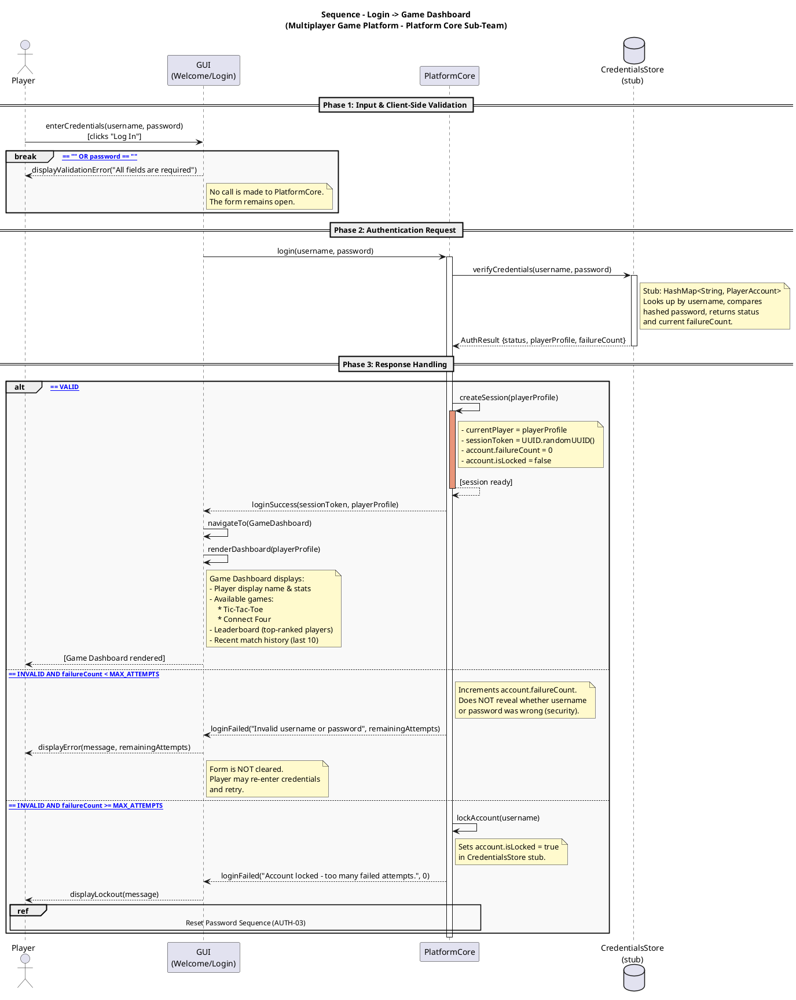

# 04.01 Login Sequence – Login → Game Dashboard

**Platform Core Sub-Team | Multiplayer Game Platform (Tic-Tac-Toe & Connect Four)**

---

## Description

The player submits credentials via the Welcome/Login GUI. The GUI first performs
client-side validation (non-empty fields); if validation fails, no call is made to
PlatformCore. Otherwise the request is forwarded to **PlatformCore**, which verifies
credentials against the **CredentialsStore stub**. On success a session is created
and the GUI transitions to the **Game Dashboard**, displaying available games
(**Tic-Tac-Toe** and **Connect Four**), player statistics, and leaderboard rankings.
On repeated failure the account is locked and the player is directed to the
Reset Password sequence (AUTH-03).

---

## Participants

| Participant | UML Kind | Responsibility |
|---|---|---|
| `Player` | Actor | Human user who fills in the login form |
| `GUI (Welcome/Login)` | Participant | Renders the login form; performs client-side validation; transitions to Game Dashboard on success |
| `PlatformCore` | Participant | Authenticates credentials; creates the session token; enforces account lockout policy |
| `CredentialsStore (stub)` | Database | In-memory stub (`HashMap<String, PlayerAccount>`) storing hashed passwords and account state |

---

## Edge Cases Covered

| # | Scenario | Trigger | System Response |
|---|---|---|---|
| 1 | **Blank fields** | `username == ""` OR `password == ""` | GUI shows validation error; no call made to PlatformCore |
| 2 | **Valid credentials** | Credentials match store entry | Session created; Game Dashboard loaded with Tic-Tac-Toe & Connect Four |
| 3 | **Invalid – retries remaining** | Mismatch; `failureCount < MAX_ATTEMPTS` | GUI shows generic error + remaining attempts; form stays open for retry |
| 4 | **Account locked** | `failureCount >= MAX_ATTEMPTS` | Account locked in stub; lockout message shown; player directed to AUTH-03 |

---

## PlantUML Diagram



---

## Stub Implementation Notes

- **`CredentialsStore (stub)`** — `HashMap<String, PlayerAccount>` where `PlayerAccount` holds:

  ```java
  String username;
  String hashedPassword;
  String sessionToken;          // null when not logged in
  boolean isLocked;
  int failureCount;
  GameStats ticTacToeStats;     // gamesPlayed, wins, losses, draws
  GameStats connectFourStats;   // gamesPlayed, wins, losses
  List<MatchRecord> recentMatches;
  ```

- **Session** — `PlatformCore` holds `private PlayerAccount currentPlayer`. On
  successful login, `sessionToken = UUID.randomUUID().toString()` is stored on the
  account and returned to the GUI.

- **Password hashing** — Use `SHA-256` or `String.hashCode()` for the stub; full
  cryptographic implementation is deferred to the database team.

- **`MAX_ATTEMPTS`** — `private static final int MAX_ATTEMPTS = 5` in `PlatformCore`.

- **Generic error message** — On invalid credentials, the system returns
  `"Invalid username or password"` regardless of whether the username or the password
  was wrong. This prevents user enumeration attacks.

- **Game Dashboard loading** — `renderDashboard(playerProfile)` uses the
  `playerProfile` object already passed via `loginSuccess(...)`. No additional store
  calls are needed at this stage. It displays:
  - **Tic-Tac-Toe** tile (navigates to TTT lobby on click)
  - **Connect Four** tile (navigates to C4 lobby on click)
  - Win/loss/draw stats from `playerProfile.ticTacToeStats`
    and `playerProfile.connectFourStats`
  - Last 10 match records from `playerProfile.recentMatches`
  - Leaderboard rankings (sorted from CredentialsStore stub on login)
