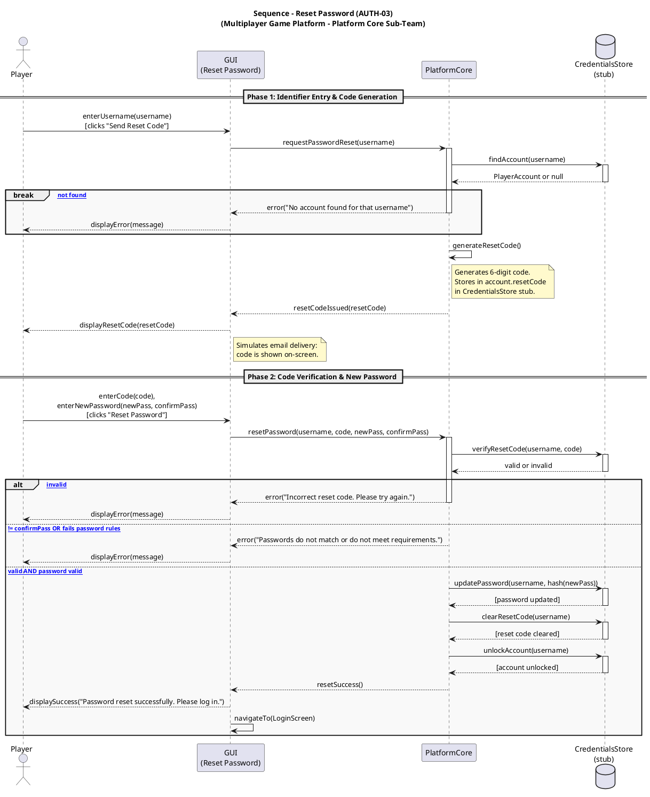

# 04.02 Reset Password Sequence – Forgot Password → Login

**Platform Core Sub-Team | Multiplayer Game Platform (Tic-Tac-Toe & Connect Four)**

---

## Description

A Player who cannot log in selects "Forgot Password?" from the Login screen.
They enter their username to receive a simulated reset code (displayed on-screen
in place of a real email). They then submit the code together with a new password.
PlatformCore verifies the code and validates the new password before updating the
CredentialsStore stub and unlocking the account. On success, the player is
returned to the Login screen.

---

## Participants

| Participant | UML Kind | Responsibility |
|---|---|---|
| `Player` | Actor | User who has forgotten their password or been locked out |
| `GUI (Reset Password)` | Participant | Renders the reset form; collects username, reset code, and new password |
| `PlatformCore` | Participant | Generates and verifies reset code; validates new password; updates the store |
| `CredentialsStore (stub)` | Database | Stores and retrieves account data including `resetCode`, `isLocked`, and `hashedPassword` |

---

## Edge Cases Covered

| # | Scenario | Trigger | System Response |
|---|---|---|---|
| 1 | **Account not found** | Username does not exist in store | Error shown; no code generated |
| 2 | **Wrong reset code** | Entered code does not match stored code | Error shown; player may retry |
| 3 | **Passwords do not match** | `newPassword != confirmPassword` | Error shown; form stays open |
| 4 | **Weak password** | New password fails validation rules | Error shown; form stays open |
| 5 | **Success** | Code valid + password valid | Password updated; account unlocked; player redirected to Login |

---

## PlantUML Diagram



---

## Stub Implementation Notes

- **`CredentialsStore (stub)`** — `PlayerAccount` requires one additional field:
  ```java
  String resetCode;  // null when no reset is in progress
  ```

- **Reset code** — A 6-digit string generated in `PlatformCore`
  (e.g., `String.format("%06d", new Random().nextInt(1_000_000))`).
  Stored in `account.resetCode` and displayed on-screen (no real email needed).

- **Password validation rules** — Enforced in `PlatformCore` before calling the store:
  - Minimum 8 characters
  - At least one digit or special character
  - Must not be identical to the current stored password

- **Account unlock** — `unlockAccount(username)` sets `account.isLocked = false`
  and `account.failureCount = 0` in the stub, allowing the player to log in
  immediately after a successful reset.
