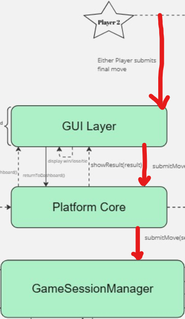
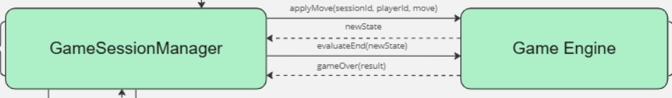
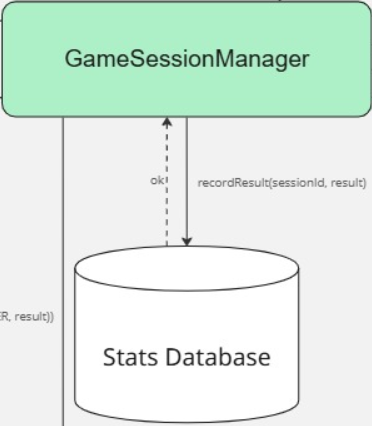

# Game Ends Sequence

---

# Basic Overview

When a game reaches its final move, the following sequence occurs:

> Player submits final (game ending) move  
> → GameSessionManager applies it using GameEngine  
> → GameEngine detects and reports terminal state  
> → SessionManager finalizes session  
> → Triggers stats/leaderboard update  
> → Publishes final game state (GAME_OVER) update  
> → GUI shows result  
> → Returns to dashboard  

---

# High-Level Flow Diagram

>Final Move\
>   &nbsp;&nbsp;&nbsp;&nbsp;&nbsp;&nbsp;&nbsp;&nbsp;&nbsp;&nbsp;↓\
>Game Engine detects winner\
>   &nbsp;&nbsp;&nbsp;&nbsp;&nbsp;&nbsp;&nbsp;&nbsp;&nbsp;&nbsp;↓\
>Result saved\
>   &nbsp;&nbsp;&nbsp;&nbsp;&nbsp;&nbsp;&nbsp;&nbsp;&nbsp;&nbsp;↓\
>Event published\
>   &nbsp;&nbsp;&nbsp;&nbsp;&nbsp;&nbsp;&nbsp;&nbsp;&nbsp;&nbsp;↓\
>GUI shows result\
>   &nbsp;&nbsp;&nbsp;&nbsp;&nbsp;&nbsp;&nbsp;&nbsp;&nbsp;&nbsp;↓\
>Back to dashboard\

# Architecture Overview

| Component | Responsibility |
|------------|---------------|
| **GUI** | What the player sees and interacts with |
| **PlatformCore** | Central coordinator |
| **GameSessionManager** | Controls lifecycle of game session |
| **GameEngine** | Contains game rules and logic |
| **Stats Store (stub)** | Saves results |
| **EventBus** | Sends updates between components |

---

# Step-by-Step Breakdown

---

## Step 1: Final Move Submission

The player makes the final move.

The move flows through the system:
 
Player -> GUI -> Core -> SessionManger

---

## Step 2: Game Logic Execution

SessionManger -> Game Engine
GameEngine -> SessionManger (newState)
SessionManager -> GameEngine (evaluateEnd)
GameEngine -> SessionManger (gameOver)

### Responsibility of GameEngine:
- Applies the player's move  
- Checks win conditions  
- Detects terminal state  
- Returns result (win/lose/tie)

---

## Step 3: Save Result

Once the game is over, the result is saved.

SessionManger -> StatsDatabase (stub)
StatsDatabase -> SessionManager (saves results and returns ok)

---

## Step 4: Notify System (Event Published)

The system is notified that the game has ended.

SessionManger -> EventBus
EventBus -> Core
Core -> GUI

A GameStateUpdate Event is published: status = GAME_OVER, result = win/lose/tie

## Step 5: GUI Displays Result

The GUI presents the outcome to the player.

GUI -> Display result (win/lose/tie)

---

## Step 6: Return to Dashboard

After viewing the result, the player returns to the dashboard.

GUI -> Core (returnToDashboard)
Core -> GUI (openDashboard)

---